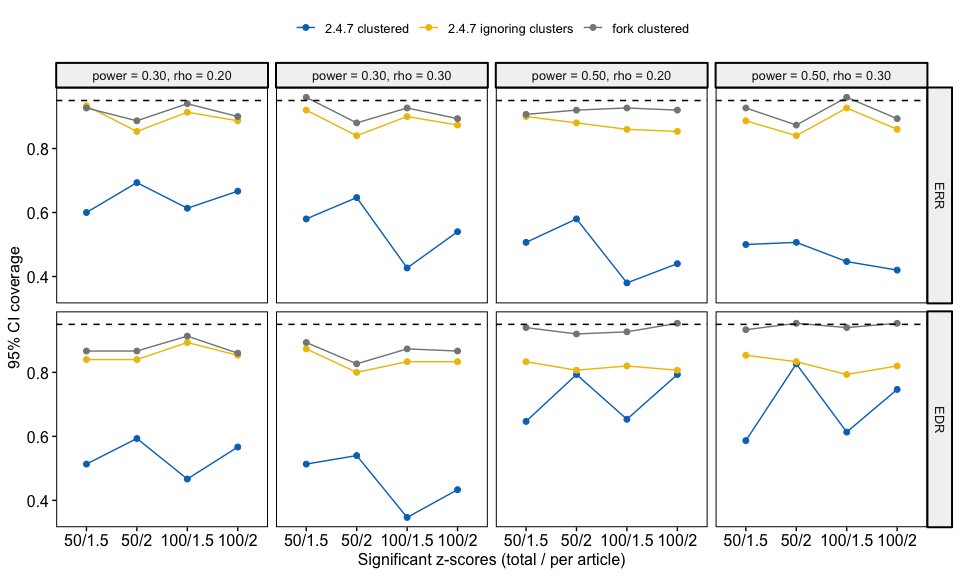
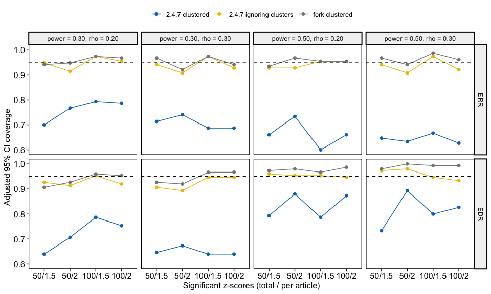
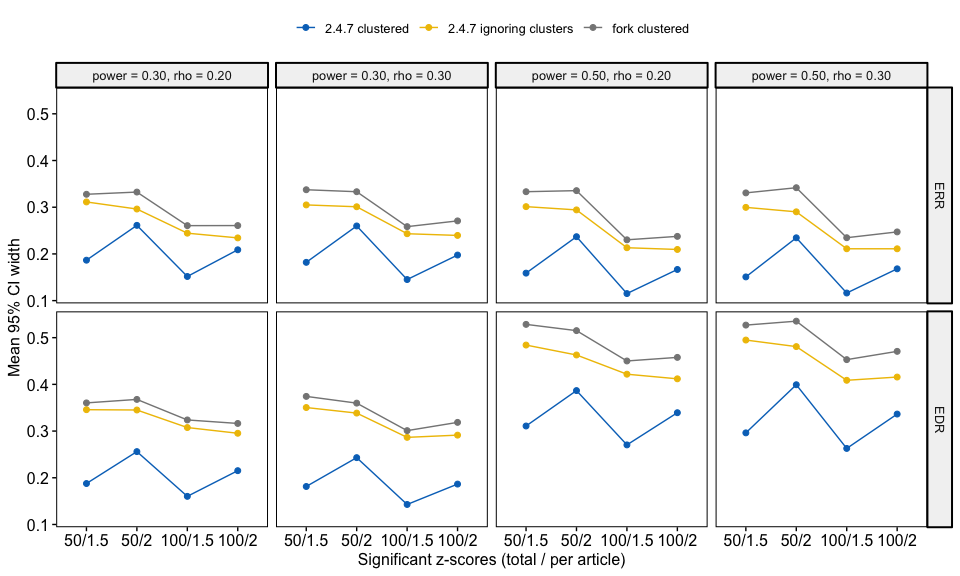
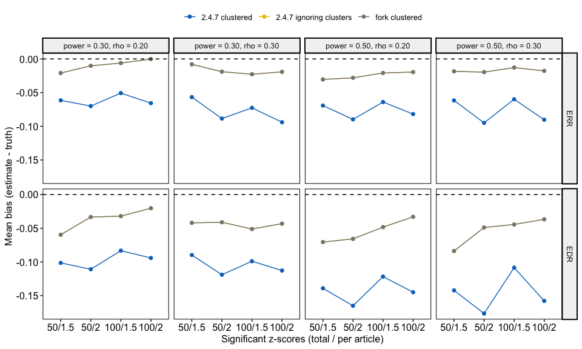
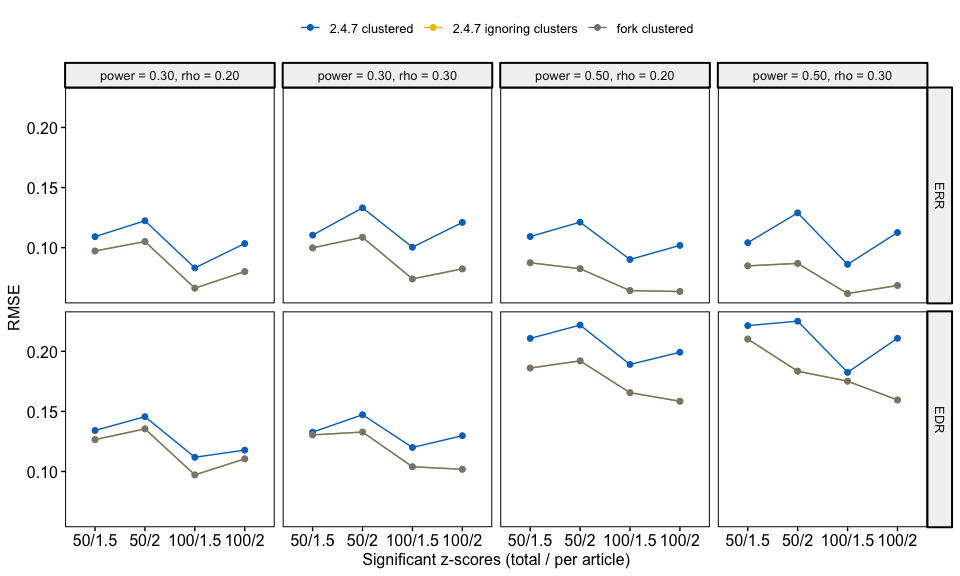

# zcurve clustered bootstrap: simulation results


- [How to run](#how-to-run)
- [Methods](#methods)
- [Overall](#overall)
- [By scenario](#by-scenario)
  - [Coverage](#coverage)
  - [Adjusted coverage](#adjusted-coverage)
  - [CI width](#ci-width)
  - [Bias](#bias)
  - [RMSE](#rmse)
- [Full table](#full-table)

*The simulation code, results and this write-up were generated by Claude
(Anthropic’s AI model, Claude Code), directed by Shaheed Azaad.*

This page summarises the simulations for
[FBartos/zcurve#36](https://github.com/FBartos/zcurve/issues/36): the
nested bootstrap in `zcurve_clustered(method = "b")` drew one z-score
per article but never resampled articles, so it ignored between-article
variability.

## How to run

Run everything from `simulations/`:

``` zsh
./run_all.sh all old unclustered fork   # every dataset, all versions
./run_all.sh                            # every dataset, fork only
./run_all.sh 36                         # quick check on the first 36 datasets, fork only
quarto render results.qmd               # rebuild results.html and README.md
```

`run_all.sh` regenerates `output/sim_data.rds` when `gen_data.R` has
changed, installs the fork from the `fix-issue-36` branch of
[shaheedazaad/zcurve](https://github.com/shaheedazaad/zcurve) into
`../lib/fork` (so push changes to the fork first), fits the chosen
versions and runs `compare.R`. By default only the fork is refitted;
existing results for the other versions are kept and still compared.
After changing `gen_data.R`, refit all versions so they use the same
data.

Settings:

- **Number of simulations per scenario**: `n_sims` at the top of
  `gen_data.R`. The scenario grid (power mixtures, `rhos`,
  `total_sig_k`, `av_sig_k_per_a`) is set just below it.
- **Number of bootstraps per fit**: `n_boot` near the top of `fit.R`.

## Methods

Data are generated by `gen_data.R`. Each article has 1 + Poisson
attempted tests, and z-scores within an article share an error term with
correlation `rho`. Only significant z-scores are kept, and articles are
added until the dataset reaches the target number of significant
results. Each article draws its power with equal probability from a
three-point mixture, {0.1, 0.3, 0.5} (mean 0.3) or {0.2, 0.5, 0.8} (mean
0.5), and all tests within an article share that power. The `power`
setting refers to the mixture mean. The true ERR and EDR are averaged
over this mixture across all attempted tests.

Each of the 16 scenarios was simulated 150 times and fitted with `fit.R`
(`n_boot` bootstraps as set in `fit.R`, 95% percentile intervals) by
three versions:

- **2.4.7 clustered**: CRAN zcurve 2.4.7,
  `zcurve_clustered(method = "b")`.
- **2.4.7 ignoring clusters**: CRAN zcurve 2.4.7,
  `zcurve(method = "EM")` treating every z-score as independent.
- **fork clustered**: the fork, where `zcurve_clustered(method = "b")`
  is a cluster bootstrap: the point estimate is fitted to all z-scores,
  and `.boot_id()` resamples articles with replacement, keeping all of
  their z-scores.

Coverage is reported for two intervals. **Raw** is the 95% percentile
bootstrap interval. **Adjusted** is the interval that `summary()`
reports: the percentile interval widened by .03 for ERR and .05 for EDR,
as proposed by Bartoš & Schimmack, bounded below by .025 (ERR) and .05
(EDR) and above by 1. The adjusted intervals are computed from the raw
bounds, so no extra fitting is needed.

With 150 simulations per scenario, the Monte Carlo standard error of a
95% coverage estimate is about 0.018.

## Overall

| Version | Fits | Failed | ERR bias | ERR coverage | ERR adj. coverage | ERR CI width | EDR bias | EDR coverage | EDR adj. coverage | EDR CI width |
|:---|---:|---:|---:|---:|---:|---:|---:|---:|---:|---:|
| 2.4.7 clustered | 2400 | 0 | -0.073 | 0.534 | 0.694 | 0.184 | -0.123 | 0.602 | 0.755 | 0.261 |
| 2.4.7 ignoring clusters | 2400 | 0 | -0.017 | 0.883 | 0.940 | 0.263 | -0.047 | 0.833 | 0.941 | 0.384 |
| fork clustered | 2400 | 0 | -0.017 | 0.915 | 0.955 | 0.292 | -0.047 | 0.905 | 0.963 | 0.416 |

## By scenario

Each panel is one combination of power and within-article correlation;
the x-axis varies the dataset size and the average number of significant
z-scores per article.

### Coverage



### Adjusted coverage



### CI width



### Bias



### RMSE



## Full table

| label | power | rho | total_sig_k | av_sig_k_per_a | n | n_failed | ERR_bias | ERR_rmse | ERR_coverage | ERR_coverage_adj | ERR_width | EDR_bias | EDR_rmse | EDR_coverage | EDR_coverage_adj | EDR_width |
|:---|---:|---:|---:|---:|---:|---:|---:|---:|---:|---:|---:|---:|---:|---:|---:|---:|
| 2.4.7 clustered | 0.3 | 0.2 | 50 | 1.5 | 150 | 0 | -0.061 | 0.109 | 0.600 | 0.700 | 0.187 | -0.101 | 0.134 | 0.513 | 0.640 | 0.188 |
| 2.4.7 ignoring clusters | 0.3 | 0.2 | 50 | 1.5 | 150 | 0 | -0.021 | 0.097 | 0.933 | 0.947 | 0.311 | -0.060 | 0.127 | 0.840 | 0.927 | 0.346 |
| fork clustered | 0.3 | 0.2 | 50 | 1.5 | 150 | 0 | -0.021 | 0.097 | 0.927 | 0.940 | 0.328 | -0.060 | 0.127 | 0.867 | 0.907 | 0.360 |
| 2.4.7 clustered | 0.3 | 0.2 | 50 | 2.0 | 150 | 0 | -0.070 | 0.122 | 0.693 | 0.767 | 0.261 | -0.111 | 0.146 | 0.593 | 0.707 | 0.256 |
| 2.4.7 ignoring clusters | 0.3 | 0.2 | 50 | 2.0 | 150 | 0 | -0.010 | 0.105 | 0.853 | 0.913 | 0.296 | -0.033 | 0.135 | 0.840 | 0.913 | 0.345 |
| fork clustered | 0.3 | 0.2 | 50 | 2.0 | 150 | 0 | -0.010 | 0.105 | 0.887 | 0.947 | 0.332 | -0.033 | 0.135 | 0.867 | 0.927 | 0.368 |
| 2.4.7 clustered | 0.3 | 0.2 | 100 | 1.5 | 150 | 0 | -0.051 | 0.083 | 0.613 | 0.793 | 0.152 | -0.083 | 0.112 | 0.467 | 0.787 | 0.160 |
| 2.4.7 ignoring clusters | 0.3 | 0.2 | 100 | 1.5 | 150 | 0 | -0.006 | 0.066 | 0.913 | 0.973 | 0.244 | -0.032 | 0.097 | 0.893 | 0.953 | 0.308 |
| fork clustered | 0.3 | 0.2 | 100 | 1.5 | 150 | 0 | -0.006 | 0.066 | 0.940 | 0.973 | 0.261 | -0.032 | 0.097 | 0.913 | 0.960 | 0.324 |
| 2.4.7 clustered | 0.3 | 0.2 | 100 | 2.0 | 150 | 0 | -0.066 | 0.103 | 0.667 | 0.787 | 0.209 | -0.094 | 0.118 | 0.567 | 0.753 | 0.215 |
| 2.4.7 ignoring clusters | 0.3 | 0.2 | 100 | 2.0 | 150 | 0 | 0.000 | 0.080 | 0.887 | 0.953 | 0.234 | -0.020 | 0.111 | 0.853 | 0.920 | 0.295 |
| fork clustered | 0.3 | 0.2 | 100 | 2.0 | 150 | 0 | 0.000 | 0.080 | 0.900 | 0.967 | 0.261 | -0.020 | 0.111 | 0.860 | 0.953 | 0.316 |
| 2.4.7 clustered | 0.3 | 0.3 | 50 | 1.5 | 150 | 0 | -0.057 | 0.110 | 0.580 | 0.713 | 0.182 | -0.090 | 0.133 | 0.513 | 0.647 | 0.181 |
| 2.4.7 ignoring clusters | 0.3 | 0.3 | 50 | 1.5 | 150 | 0 | -0.008 | 0.100 | 0.920 | 0.940 | 0.305 | -0.042 | 0.130 | 0.873 | 0.907 | 0.350 |
| fork clustered | 0.3 | 0.3 | 50 | 1.5 | 150 | 0 | -0.008 | 0.100 | 0.960 | 0.967 | 0.337 | -0.042 | 0.130 | 0.893 | 0.927 | 0.374 |
| 2.4.7 clustered | 0.3 | 0.3 | 50 | 2.0 | 150 | 0 | -0.089 | 0.133 | 0.647 | 0.740 | 0.260 | -0.119 | 0.147 | 0.540 | 0.673 | 0.243 |
| 2.4.7 ignoring clusters | 0.3 | 0.3 | 50 | 2.0 | 150 | 0 | -0.019 | 0.109 | 0.840 | 0.907 | 0.301 | -0.041 | 0.133 | 0.800 | 0.893 | 0.339 |
| fork clustered | 0.3 | 0.3 | 50 | 2.0 | 150 | 0 | -0.019 | 0.109 | 0.880 | 0.920 | 0.333 | -0.041 | 0.133 | 0.827 | 0.920 | 0.360 |
| 2.4.7 clustered | 0.3 | 0.3 | 100 | 1.5 | 150 | 0 | -0.073 | 0.100 | 0.427 | 0.687 | 0.145 | -0.099 | 0.120 | 0.347 | 0.640 | 0.143 |
| 2.4.7 ignoring clusters | 0.3 | 0.3 | 100 | 1.5 | 150 | 0 | -0.023 | 0.074 | 0.900 | 0.973 | 0.243 | -0.051 | 0.104 | 0.833 | 0.947 | 0.287 |
| fork clustered | 0.3 | 0.3 | 100 | 1.5 | 150 | 0 | -0.023 | 0.074 | 0.927 | 0.973 | 0.258 | -0.051 | 0.104 | 0.873 | 0.967 | 0.301 |
| 2.4.7 clustered | 0.3 | 0.3 | 100 | 2.0 | 150 | 0 | -0.094 | 0.121 | 0.540 | 0.687 | 0.198 | -0.113 | 0.130 | 0.433 | 0.640 | 0.186 |
| 2.4.7 ignoring clusters | 0.3 | 0.3 | 100 | 2.0 | 150 | 0 | -0.019 | 0.082 | 0.873 | 0.927 | 0.240 | -0.043 | 0.102 | 0.833 | 0.947 | 0.291 |
| fork clustered | 0.3 | 0.3 | 100 | 2.0 | 150 | 0 | -0.019 | 0.082 | 0.893 | 0.940 | 0.271 | -0.043 | 0.102 | 0.867 | 0.967 | 0.319 |
| 2.4.7 clustered | 0.5 | 0.2 | 50 | 1.5 | 150 | 0 | -0.069 | 0.109 | 0.507 | 0.660 | 0.159 | -0.139 | 0.211 | 0.647 | 0.793 | 0.311 |
| 2.4.7 ignoring clusters | 0.5 | 0.2 | 50 | 1.5 | 150 | 0 | -0.030 | 0.087 | 0.900 | 0.927 | 0.301 | -0.071 | 0.186 | 0.833 | 0.960 | 0.484 |
| fork clustered | 0.5 | 0.2 | 50 | 1.5 | 150 | 0 | -0.030 | 0.087 | 0.907 | 0.933 | 0.333 | -0.071 | 0.186 | 0.940 | 0.973 | 0.528 |
| 2.4.7 clustered | 0.5 | 0.2 | 50 | 2.0 | 150 | 0 | -0.090 | 0.121 | 0.580 | 0.733 | 0.237 | -0.165 | 0.222 | 0.793 | 0.880 | 0.387 |
| 2.4.7 ignoring clusters | 0.5 | 0.2 | 50 | 2.0 | 150 | 0 | -0.028 | 0.082 | 0.880 | 0.927 | 0.294 | -0.066 | 0.192 | 0.807 | 0.953 | 0.463 |
| fork clustered | 0.5 | 0.2 | 50 | 2.0 | 150 | 0 | -0.028 | 0.082 | 0.920 | 0.967 | 0.335 | -0.066 | 0.192 | 0.920 | 0.980 | 0.515 |
| 2.4.7 clustered | 0.5 | 0.2 | 100 | 1.5 | 150 | 0 | -0.064 | 0.090 | 0.380 | 0.600 | 0.115 | -0.122 | 0.189 | 0.653 | 0.787 | 0.270 |
| 2.4.7 ignoring clusters | 0.5 | 0.2 | 100 | 1.5 | 150 | 0 | -0.021 | 0.064 | 0.860 | 0.953 | 0.213 | -0.048 | 0.166 | 0.820 | 0.953 | 0.422 |
| fork clustered | 0.5 | 0.2 | 100 | 1.5 | 150 | 0 | -0.021 | 0.064 | 0.927 | 0.953 | 0.230 | -0.048 | 0.166 | 0.927 | 0.967 | 0.450 |
| 2.4.7 clustered | 0.5 | 0.2 | 100 | 2.0 | 150 | 0 | -0.082 | 0.102 | 0.440 | 0.660 | 0.167 | -0.145 | 0.199 | 0.793 | 0.873 | 0.339 |
| 2.4.7 ignoring clusters | 0.5 | 0.2 | 100 | 2.0 | 150 | 0 | -0.019 | 0.064 | 0.853 | 0.953 | 0.210 | -0.033 | 0.158 | 0.807 | 0.947 | 0.412 |
| fork clustered | 0.5 | 0.2 | 100 | 2.0 | 150 | 0 | -0.019 | 0.064 | 0.920 | 0.953 | 0.238 | -0.033 | 0.158 | 0.953 | 0.987 | 0.458 |
| 2.4.7 clustered | 0.5 | 0.3 | 50 | 1.5 | 150 | 0 | -0.062 | 0.104 | 0.500 | 0.647 | 0.151 | -0.142 | 0.221 | 0.587 | 0.733 | 0.296 |
| 2.4.7 ignoring clusters | 0.5 | 0.3 | 50 | 1.5 | 150 | 0 | -0.018 | 0.085 | 0.887 | 0.940 | 0.300 | -0.084 | 0.210 | 0.853 | 0.973 | 0.495 |
| fork clustered | 0.5 | 0.3 | 50 | 1.5 | 150 | 0 | -0.018 | 0.085 | 0.927 | 0.967 | 0.331 | -0.084 | 0.210 | 0.933 | 0.980 | 0.527 |
| 2.4.7 clustered | 0.5 | 0.3 | 50 | 2.0 | 150 | 0 | -0.095 | 0.129 | 0.507 | 0.633 | 0.234 | -0.177 | 0.225 | 0.827 | 0.893 | 0.399 |
| 2.4.7 ignoring clusters | 0.5 | 0.3 | 50 | 2.0 | 150 | 0 | -0.020 | 0.087 | 0.840 | 0.907 | 0.290 | -0.049 | 0.183 | 0.833 | 0.980 | 0.481 |
| fork clustered | 0.5 | 0.3 | 50 | 2.0 | 150 | 0 | -0.020 | 0.087 | 0.873 | 0.940 | 0.342 | -0.049 | 0.183 | 0.953 | 1.000 | 0.535 |
| 2.4.7 clustered | 0.5 | 0.3 | 100 | 1.5 | 150 | 0 | -0.060 | 0.086 | 0.447 | 0.667 | 0.116 | -0.109 | 0.182 | 0.613 | 0.800 | 0.263 |
| 2.4.7 ignoring clusters | 0.5 | 0.3 | 100 | 1.5 | 150 | 0 | -0.013 | 0.062 | 0.927 | 0.973 | 0.211 | -0.044 | 0.175 | 0.793 | 0.947 | 0.409 |
| fork clustered | 0.5 | 0.3 | 100 | 1.5 | 150 | 0 | -0.013 | 0.062 | 0.960 | 0.987 | 0.235 | -0.044 | 0.175 | 0.940 | 0.993 | 0.453 |
| 2.4.7 clustered | 0.5 | 0.3 | 100 | 2.0 | 150 | 0 | -0.090 | 0.113 | 0.420 | 0.627 | 0.168 | -0.158 | 0.211 | 0.747 | 0.827 | 0.336 |
| 2.4.7 ignoring clusters | 0.5 | 0.3 | 100 | 2.0 | 150 | 0 | -0.018 | 0.069 | 0.860 | 0.920 | 0.211 | -0.037 | 0.160 | 0.820 | 0.933 | 0.416 |
| fork clustered | 0.5 | 0.3 | 100 | 2.0 | 150 | 0 | -0.018 | 0.069 | 0.893 | 0.960 | 0.247 | -0.037 | 0.160 | 0.953 | 0.993 | 0.471 |
